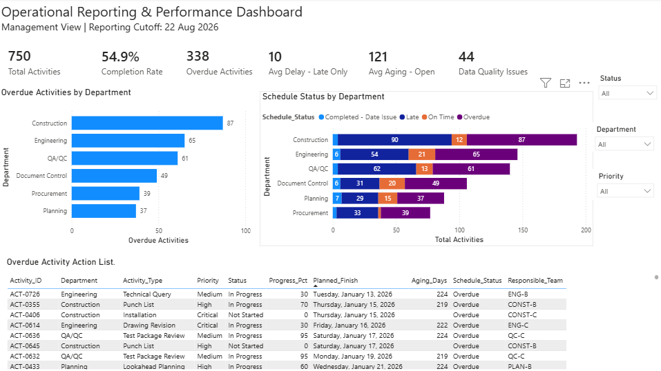

# Operational reporting you can refresh

Activity trackers collect missing fields, inconsistent categories, duplicate IDs, and dates that do not line up. A simple overdue count is then hard to trust. This demo turns that kind of tracker into a report that rebuilds on refresh: overdue work, how it sits by department, and a list of what to follow up.

## What you'd get

- A [sample activity tracker](01_Data/Raw/operations_raw.csv) and the [cleaned table](01_Data/Cleaned/operations_clean.csv) produced from it
- An [Excel workbook](02_PowerQuery/operations_reporting_cleaning.xlsx) with Power Query steps that standardize text, check dates, and flag overdue items and data-quality issues
- A [Power BI report](03_PowerBI/operations_reporting_dashboard.pbix) with overdue workload, schedule status, filters, and an overdue action list, plus a [screenshot](04_Images/dashboard_screenshot.png) of that report
- A short [findings note](05_Documentation/key_findings.md) for the saved snapshot

All data in this repo is synthetic demo/sample data, not client work. No real employer or client data is used.



## Business Problem

Operational trackers mix incomplete updates, inconsistent categories, duplicate IDs, and invalid dates. Management needs a dependable view of overdue work and departmental risk without allowing questionable source records to distort the reporting.

## Solution

```text
Raw CSV → Excel Power Query → cleaning and standardization
→ validation and calculated fields → clean CSV
→ Power BI and DAX → dashboard → insights and follow-up priorities
```

## Data

The [raw dataset](01_Data/Raw/operations_raw.csv) contains **750 synthetic activities across six departments**. The saved report uses the cutoff **22 August 2026**.

The [cleaned dataset](01_Data/Cleaned/operations_clean.csv) preserves source activity IDs and adds a unique `Record ID`, date checks, cleaned actual-finish dates, cycle time, delay, aging, overdue flags, and data-quality classifications. Six records are marked as affected by duplicated source IDs; this is separate from the 44 primary data-quality issues.

## Analysis

- Completion, overdue workload, completed-work delay, and aging of open activities.
- Departmental backlog volume and proportional overdue exposure.
- High/Critical-priority overdue work and records requiring validation review.
- An overdue action list with department, responsible team, priority, dates, and aging.

## Decision Support

Construction has the largest overdue backlog (**87 activities**). Procurement has the highest proportional overdue exposure (**39 of 77 activities, approximately 50.6%**). These findings support separate workload and performance reviews.

The [findings](05_Documentation/key_findings.md) recommend prioritizing **153 High/Critical overdue activities**, escalating aging work, and resolving source-data issues before using affected dates in performance measures.

## Automated Action

Power Query applies repeatable preparation and validation steps; Power BI presents the resulting metrics and action list. The saved workflow includes a cleaned CSV handoff. Refreshing the workbook, exporting the cleaned table, and refreshing the report are user-run steps; unattended scheduling and automatic task assignment are not demonstrated.

## Measured / Demonstrated Outcome

**Saved snapshot:** 750 activities, 338 overdue, 44 records with primary data-quality issues.

| Measure | Saved snapshot |
|---|---:|
| Activities / completed | 750 / 412 |
| Completion rate | 54.9% |
| Overdue activities | 338 |
| Average delay among late completed activities | Approximately 9.6 days |
| Average aging among open activities | Approximately 121.5 days |
| Primary data-quality issues | 44 records |

The primary issue categories contain 30 invalid actual-date sequences, 8 missing priorities, and 6 missing descriptions. Additional date-check and duplicate flags remain inspectable in the cleaned data. These are demonstration results from the sample file, not measured savings or productivity gains.

## Tools

Microsoft Excel, Power Query, Power BI, DAX, and CSV files.

## How to Run

1. Download the repository and open the [Excel workbook](02_PowerQuery/operations_reporting_cleaning.xlsx) in Excel with Power Query support.
2. In Power Query, update the source path to your local copy of [operations_raw.csv](01_Data/Raw/operations_raw.csv), then refresh and inspect the validation fields.
3. Export the refreshed `operations_clean` table to [operations_clean.csv](01_Data/Cleaned/operations_clean.csv), retaining its headers.
4. Open the [Power BI file](03_PowerBI/operations_reporting_dashboard.pbix) in Power BI Desktop, update its source path to your local copy of the cleaned CSV, and refresh. Keep the reporting cutoff of 22 August 2026 if you want to compare with the saved snapshot.

The committed workbook, report, screenshot, and findings can also be reviewed directly without refreshing the data.

[Portfolio overview](https://github.com/23-06109#selected-projects)

## Work with me

I offer a fixed-price, async Operations Reporting Automation Sprint: you send a messy Excel/CSV tracker, I send back a clean report that rebuilds on refresh, an overdue action list and a short how-to video. No meetings. Message me on LinkedIn: https://www.linkedin.com/in/jimmyjrmanalon/
